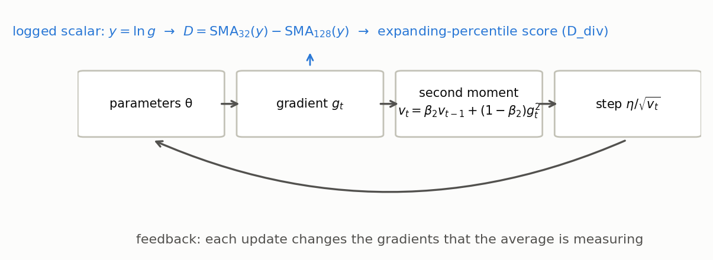
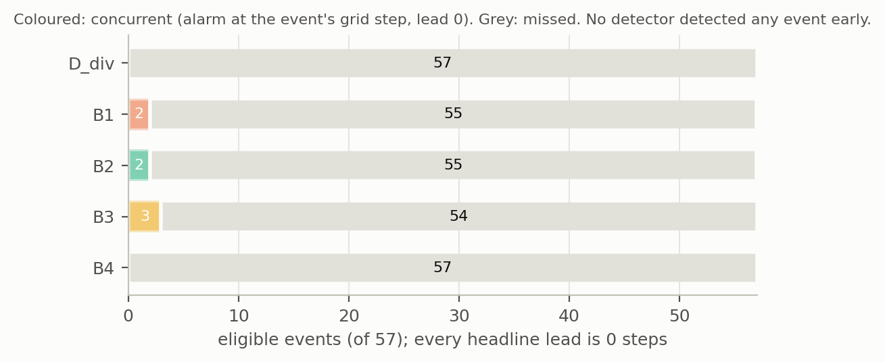
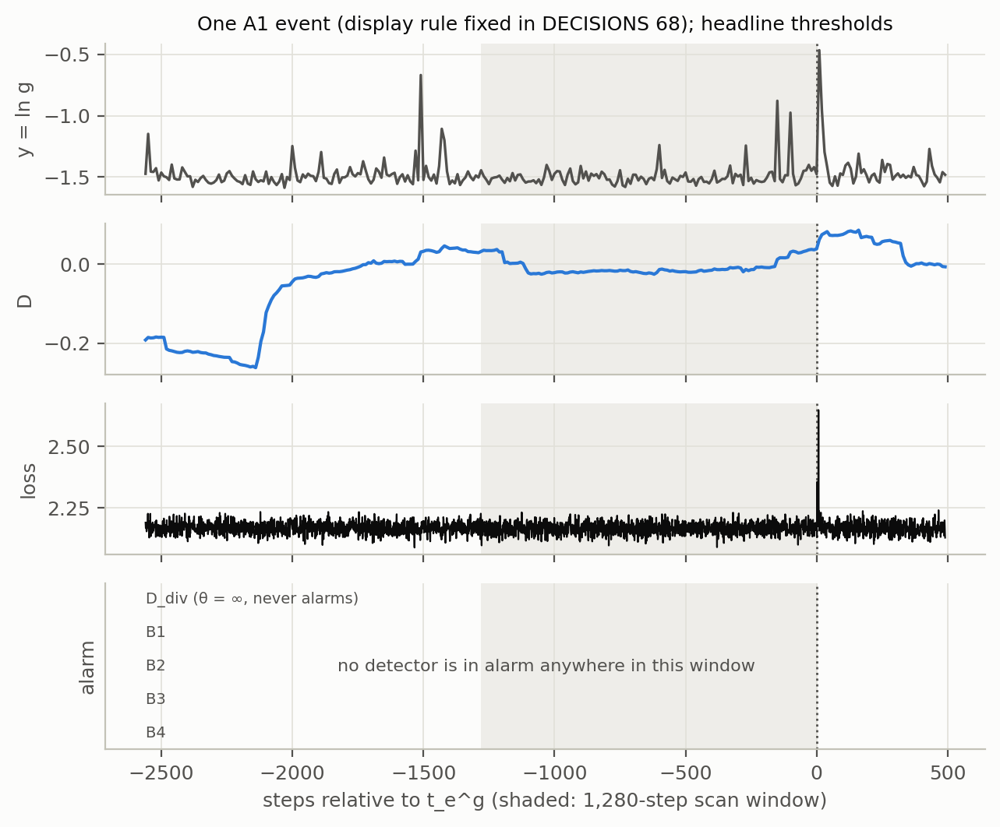
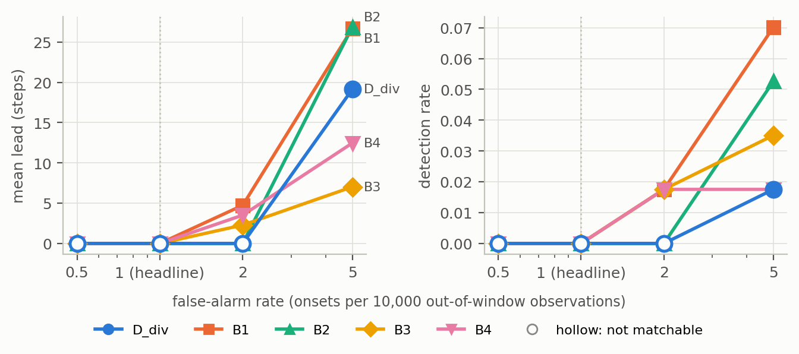
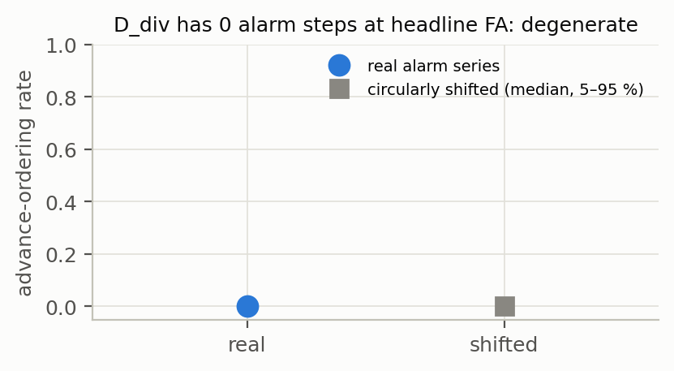
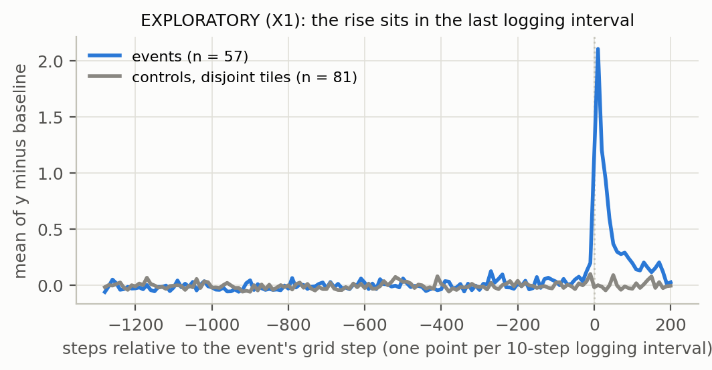

# Abstract

Loss spikes in large-model training are often preceded by a rise in the gradient norm. Deployed spike alarms compare each new reading with a trailing summary, which makes each of them a fast–slow divergence with a one-step fast window. We asked whether smoothing the fast window helps: does a 32-versus-128-observation divergence of the log gradient norm (D_div) warn of loss spikes earlier than four deployed-style baselines, at a matched false-alarm rate?

The design, the data rule and a kill rule were pre-registered [DOI 10.5281/zenodo.23825294] and tested on the public training log of a 7B model, OLMo-0424, with 57 eligible spike events. At one false alarm per 10,000 observations the result is REFUTE (C_min = 0.0).
- D_div could not be matched at that rate: its threshold is ∞ and it never alarmed.
- No baseline gave any early warning either.
- The project stopped as registered.

The registered reading rules qualify this. On a synthetic copy of the run's layout with no precursor, the decision rule returns REFUTE 87% of the time. The REFUTE therefore says that D_div did not beat the baselines at matched false-alarm rate. It is not evidence that precursors are absent.

An exploratory diagnostic finds a gradient-norm rise before the spikes, concentrated in the final 10-step logging interval. At this logging cadence, a smoothed alarm cannot use it.

**Keywords:** loss spikes; training instability; early warning; Adam; gradient norm; pre-registration; negative result

# 1 Introduction {#sec-1}

**The cost.** Loss spikes are among the costliest events in large-model training. A run that spikes is typically rewound to a checkpoint and the offending batches are skipped [@Chowdhery-2023]. Reports from large runs tie spikes to growth in the gradient norm before the loss moves [@Walsh-2025] [@Takase-2025].

**Existing alarms.** Tools that watch for spikes compare the current gradient norm with a trailing statistic: a z-score against an exponential average, a ratio, or a cumulative sum [@Kumar-2025] [@Huang-2025a] [@trainscope-2026]. Each is a fast–slow divergence whose fast window is a single reading.

**The question.** A natural question is whether a smoothed fast window, which trades single-reading response for noise rejection, warns earlier at the same false-alarm rate.

**This paper.** We pre-registered that question with a kill rule before scoring any data, and tested it on a public 7B training log. The answer is no.
- The smoothed detector could not be matched at the headline false-alarm rate, and no detector, smoothed or not, warned of any spike in advance (@sec-4.2, @TBL-3).
- We report the verdict with the severity figures fixed before the run (@sec-4.3) and the pre-registered secondary analyses.
- An exploratory diagnostic explains the failure at this logging cadence.

`L-01` We do not propose a new instability mechanism. That the second-moment estimate lags the squared gradients is prior art (@sec-2.2). {#L-01}

The contribution is a clean, fully ledgered null on a question practitioners ask: every number is quoted from a committed ledger, and the data are hash-pinned.

# 2 Related Work {#sec-2}

## 2.1 Spike precursors and deployed alarms {#sec-2.1}

The deployed tools follow the same pattern:
- **ZClip** keeps an exponential mean and variance of the gradient norm and flags readings far above them [@Kumar-2025].
- **SPAM** tests the current gradient against a running second moment [@Huang-2025a].
- **trainscope** runs a robust CUSUM change-point detector on a logged scalar [@trainscope-2026].

In the terms used here, each compares a one-reading fast window with a slow summary. We implement B3 and B4 from the ZClip and trainscope source (@sec-3.2, @TBL-1).

Mitigation methods change the update rather than warn [@Huang-2026] [@Wang-2025]. A failure-risk score with lead times has been proposed for job failures rather than loss spikes [@Fatima-2025].

## 2.2 Second-moment lag mechanism {#sec-2.2}

That Adam's second-moment estimate can fall out of date relative to the gradients, and that this precedes instability, is established:
- out-of-date second-moment estimates in Adafactor [@Shazeer-2018];
- underestimation before spikes, with lower β₂ as a remedy [@Wortsman-2023];
- time-domain gradient correlation [@Molybog-2023];
- qualitative (β₁, β₂) regimes [@Ma-2022];
- adaptive preconditioners triggering spikes [@Bai-2026a];
- fitted and derived stability phase diagrams [@Tang-2026] [@Bai-2026b].

We do not claim this mechanism. We use it only to motivate watching the logged gradient norm.

## 2.3 Edge of stability and the curvature boundary {#sec-2.3}

Curvature analyses locate instability at a sharpness boundary, both for gradient descent [@Cohen-2021] and for preconditioned methods with the preconditioner held fixed [@Cohen-2022]. Our question is complementary: whether a logged scalar warns before the crossing. We return to this in @sec-5.3.

# 3 Methods {#sec-3}

Everything in this section was registered before the primary data were scored. It is the frozen design at the `prereg-v1` tag [DOI 10.5281/zenodo.23825294], together with the dated, public amendments listed in @sec-3.8. Where an amendment changed an operator, it is named at the point of use.

## 3.1 The detector D_div {#sec-3.1}

Adam [@Kingma-2015] scales each step by a trailing average of squared gradients (@EQ-8),

$$ v_t = \beta_2 v_{t-1} + (1-\beta_2)\, g_t^2, \qquad \Delta\theta_t \propto \eta / \sqrt{v_t}. $$ {#EQ-8}

Its preconditioner is therefore a lagged measurement of a quantity that the measurement itself feeds back into: a measurement-feedback loop in the sense of [@Kim-2026d] (@FIG-1). That reading motivates watching the logged gradient norm for the moment its recent level departs from its longer-run level.

Figure @FIG-1: Adam as a measurement-feedback loop, and the fast–slow divergence read off the gradient norm. {#FIG-1}

The observable is the pre-clip global gradient norm g, taken in logs (@EQ-1):

$$ y(t) = \ln g(t). $$ {#EQ-1}

The divergence is the difference of two simple moving averages of y (@EQ-2):

$$ D(t) = \mathrm{SMA}_{32}(y)(t) - \mathrm{SMA}_{128}(y)(t). $$ {#EQ-2}

The window ratio of 4 lies inside the window-ratio band of [@Kim-2026c, Thm 14]. A fast–slow divergence onset detector, with a fixed threshold on D, has been compared with a level rule before [@Kim-2026b]. To our knowledge, the expanding-percentile score with false-alarm-matched thresholds used here is new. The detector score is the expanding empirical percentile of D(t) among all earlier values since the last gap (@EQ-3). Ties are counted as ≤, the moving averages include the current reading, and no score is defined before 1,000 observations of history (Amendment 5).

$$ P_D(t) = \frac{\#\{s \le t : D(s) \le D(t)\}}{\#\{s \le t\}}, \qquad \text{alarm when } P_D(t) \ge \theta_{\mathrm{div}}. $$ {#EQ-3}

Two cited results frame D_div; neither is re-proved here.

- **Crossing lead (motivation).** After a level change, the fast average crosses a fixed level ahead of the slow average, by (w_s − w_f)/2 at the midpoint [@Kim-2026a, Thm 3.1] (@EQ-5). This motivates watching their difference. It does not bound the detector's lead over a loss spike, which is what E2 measures. `L-05` We claim no analytical bound on that lead. {#L-05}

$$ \Delta t_{\text{cross}} = \alpha\,(w_s - w_f), \qquad \tfrac{1}{2}(w_s - w_f) \text{ at the midpoint}. $$ {#EQ-5}

- **Persistence sign.** The sign of D's forward correlation with y is fixed in advance by the autocorrelation function, through [@Kim-2026c, Thm 8b, Def 13] (@EQ-6, @sec-3.6). For A1 the registered criterion predicts sign 1.

`S1` Every operator is causal and reads only scalars already present in a training log. No curvature quantity is computed. {#S1}

## 3.2 Baselines B1–B4 {#sec-3.2}

Deployed spike alarms compare the current reading with a trailing summary, so each is a fast–slow divergence whose fast window is one step [@Kumar-2025] [@Huang-2025a] [@trainscope-2026]. We compare D_div with four such baselines (@TBL-1), each producing a scalar score that alarms at or above its threshold.

- B3 and B4 follow their tools' published source. Both are vendored, and both were brought into line with the source by Amendments 5 and 9.
- Each has a documented decision threshold. That threshold is reported as an unmatched operating point, but every contrast uses thresholds matched to a common false-alarm rate (@sec-3.5).

| Detector | Score | Parameters (A1 grid observations) | Source or pin |
|---|---|---|---|
| D_div | percentile of D (@EQ-3) | w_f = 32, w_s = 128; history ≥ 1,000 | this paper |
| B1 | rolling z-score of y | window 50 | pin P-B1 (sweep 25/100 in E4) |
| B2 | y itself (fixed threshold) | — | — |
| B3 | EMA z-score of g, monitor mode (raw g updates the EMA) | α = 0.97, warm-up 25 | ZClip 1.0.0 [@Kumar-2025]; pin P-B3 |
| B4 | upward CUSUM on a robust z of y; reset at onsets and gaps | median/MAD over 200 (min 30), slack k = 1.0 | trainscope @ 0651b25 [@trainscope-2026]; pin P-B4 |

Table @TBL-1: Detector definitions. On A1, B3's α and warm-up are per grid observation. That is a construction choice under P-B3, not ZClip's per-step behaviour (Amendment 1). {#TBL-1}

## 3.3 Data: primary run A1 {#sec-3.3}

The primary run, A1, is the public training log of OLMo-0424, a 7B-parameter model [@Walsh-2025], read from its public Weights & Biases records. Every file was staged after `prereg-v1` and pinned by SHA-256 (@app-D).

`S2` g is the pre-clip global gradient norm. A run that logs only the post-clip norm would be reported separately and never pooled. {#S2}

`S3` A1 used β₂ = 0.95, a second-moment memory of about 20 steps. The detector windows (32 and 128 observations) are well beyond the optimizer's own memory. The test therefore asks whether the alarm warns, not how β₂ shapes the spikes. {#S3}

`S11` **Logging grid.** A1 logs the gradient norm every 10 steps, and its loss every step (Amendment 1).
- The detectors therefore run on the 10-step grid: windows 320 and 1,280 steps, lead resolution 10 steps, hold 320 steps, and a scan window of 1,280 steps.
- Each event is anchored at its last grid step at or before the spike.
- A precursor shorter than about 320 steps favours baselines that read the raw value. We state this as a scope condition; it does not qualify the kill rule. {#S11}

`S5` **Assembly.** A1 is assembled from consecutive run segments by the registered rule P-SEG, as clarified in Amendment 2: a later run wins ties, and supersession is decided by resume step. {#S5}

`S12` **Gaps.** Where a superseding segment's log is incomplete, the kept series has a gap. Every detector restarts after each gap, with its minimum-history cost. The kept series is three blocks, [1, 14,200], [52,301, 160,500] and [160,601, 504,500], with internal gaps between them (@TBL-2). No window crosses a gap. {#S12}

| Item | A1 |
|---|---|
| Run | OLMo-0424 (7B), public W&B logs; route-1 history files plus route-1b windowed exports, all SHA-256-pinned |
| Kept blocks (steps) | [1, 14,200], [52,301, 160,500], [160,601, 504,500] |
| Covered ranges (kept blocks plus rewind portions) | 1–14,210 and 52,301–504,510 |
| Detector grid | every 10 steps; loss every step |
| A2–A6 | not staged: the registered stop rule ended the project first |

Table @TBL-2: Data. A1 is the only scored run. {#TBL-2}

`S14` **Coverage.** Every A1 quantity in this paper is conditional on A1's covered ranges: the eligible-event count, n*, the verdict, and the exploratory diagnostics. The uncovered range, 14,211–52,300 and the end of the run, is a stated selection threat. We do not observe what it would have changed; any statement about it is a projection. {#S14}

## 3.4 Spike events and the k ladder {#sec-3.4}

A loss spike at step t is defined from the per-step loss alone (@EQ-4):

$$ L(t) > \mathrm{SMA}_{128}(L)(t-1) + k\,\sigma_{128}(L)(t-1). $$ {#EQ-4}

- σ is the sample standard deviation over the finite values of the trailing 128 steps.
- A step is tested only when its window lies in one block and holds at least 64 finite values (Amendment 3). A non-finite loss counts as exceeding.
- Spikes are merged by chained deduplication into events. On A1 the merge distance is 2,000 steps, not the frozen 200: with a 1,280-step scan window, a 200-step merge would let consecutive scan windows overlap (Amendment 1).
- The event time t_e is the first spike of the event.
- An event is eligible when every detector has a score over its whole scan window: at least 1,000 observations of post-gap history, and no gap in the window. Ineligible events are counted, and their windows still leave the false-alarm count.
- The rung of the k ladder (k = 4, else k = 3 once) is resolved from the loss before any detector score is computed.

`S10` Spikes that a restart superseded would be kept as rewind events on their own series. Rewind portions on unused segments are counted as unscorable. {#S10}

`S13` Under chained deduplication, the events at a lower threshold are not a superset of those at a higher one, because dense low-rung spikes merge into long chains. {#S13}

Event counts are reported in @sec-4.1.

## 3.5 Alarm onset and hold, P-FA matching, lead, contrast C_min, the kill rule and grading day {#sec-3.5}

**Alarm onset and hold (@EQ-11).**
- An onset is a fresh crossing: s(j) ≥ θ with s(j − 1) < θ, while the detector is not already in alarm. An undefined previous score counts as below θ (Amendment 7.3).
- Each onset holds the alarm for H = 32 observations.

**False-alarm rate and matching.**
- The false-alarm rate (FA) is onsets per 10,000 out-of-window observations. The denominator N_out is common to all detectors: scored observations outside every event's scan window, eligible or not (Amendment 7.2).
- For a target FA, each detector's threshold is matched to the same onset count n* = round-half-up(FA × N_out / 10,000). θ is found by scanning candidate scores from the top (Amendment 6). B4's candidates come from its reset-free path, and its count is recomputed with resets (Amendment 7.1).
- A detector is **unmatchable** at a target when even its top score yields more than n* out-of-window onsets. Its θ is then ∞, and it never alarms.
- The headline FA is 1 per 10,000. The grid {0.5, 2, 5} is reported without verdict.

$$ n^* = \Big\lfloor \tfrac{\mathrm{FA}\cdot N_{\text{out}}}{10{,}000} + \tfrac12 \Big\rfloor, \qquad \theta = \min\{v : c(v) \le n^*\}. $$ {#EQ-11}

`S8` **Lead and censoring.** Lead is measured in the scan window of 129 observations ending at the event's grid step t_e^g.
- **Lead:** t_e^g minus the first in-window alarm.
- **Miss:** no in-window alarm. Lead 0.
- **Concurrent:** the first in-window alarm falls at t_e^g itself. Lead 0, counted separately (Amendment 7.6).
- **Left-censored:** an alarm already on at the window start. Lead 1,280 steps, flagged. {#S8}

**Contrast (@EQ-7).** The contrast is taken on mean lead over the eligible events:

$$ C_b = \overline{\text{lead}}(D_{\mathrm{div}}) - \overline{\text{lead}}(B_b), \qquad C_{\min} = \min_{b \in \{1,2,3,4\}} C_b . $$ {#EQ-7}

**Labels.** The verdict is taken on the point estimate.
- REFUTE if C_min ≤ 0.
- Otherwise, the 5th percentile of C_min over 1,000 joint resamples of events separates SUPPORT from INCONCLUSIVE. C_min is recomputed within each resample.

`S7` Events at least 200 observations apart are treated as independent for resampling. Resampling blocks of three consecutive events is reported as a sensitivity (E4). {#S7}

The kill rule and grading day, verbatim from `prereg-v1` [DOI 10.5281/zenodo.23825294]. Three clauses naming a repository record file are elided as […]; the full registered text is at the DOI.

> **Grading day:** `prereg-v1` commit date + 21 days. The concrete calendar date is written here and in THESIS.md's Date station in the `prereg-v1` commit itself: **2026-11-20** (`prereg-v1` commit dated 2026-10-30). On that day the verdict is recorded in DECISIONS.md […] whether or not E2 has run; an unrun E2 (including A1 unavailable under D.1) is itself recorded and the day is re-set once, by dated amendment. If E2 is still unrun on the re-set day, §K returns CLOSE with a short null note on data availability (F11).
>
> **Rule:** after E2's single real run on A1: if E2 is **REFUTE (C_min ≤ 0)** — D_div's mean lead at headline FA (1 onset per 10,000 out-of-window steps, hold H = 32) does not exceed that of the best of B1–B4 (point estimate) — the project STOPS. The negative is written up as a short null note (Standard: the null is the paper), filed in the repo and on Zenodo […]; Leg B does not run. If E2 is **INSUFFICIENT EVENTS** (fewer than 5 eligible events on A1 at k = 4 and at k = 3), the project also closes: a short null note on event count is filed (neither a pass nor a kill of Claim A) […], and Leg B does not run. INCONCLUSIVE or SUPPORT → Leg B proceeds. No re-tuning of windows, spike definition, baselines, construction pins, or FA grid after A1 is touched; E4's sensitivity results are reported as they fall and do not rescue the verdict.

For A1, Amendment 1 (A1.10) reads the rule's "1 onset per 10,000 out-of-window steps, hold H = 32" as per 10,000 out-of-window grid observations, with the hold in observations. The grading day was re-set once by Amendment 16 and fixed by Amendment 17 (@sec-3.8). The rule itself was not changed.

## 3.6 Pre-registered secondary analyses {#sec-3.6}

None of these carries a verdict on the central claim.

- **E1, persistence-sign consistency check.** It compares the sign of Corr(D_t, y_{t+16}) with the sign predicted from the ACF (@EQ-6). The ACF is pooled within blocks over lags 0–256. Significance comes from a one-sided permutation of 128-observation pieces of the target, 1,000 permutations. The labels are CONSISTENT, INCONSISTENT and INDETERMINATE.

$$ \operatorname{sign}\big[\bar R(h, h + w_f) - \bar R(h + w_f, h + w_s)\big], \quad \bar R(a,b) = \tfrac{1}{b-a}\textstyle\sum_{\tau=a}^{b-1}\hat\rho_y(\tau), \ h = 16. $$ {#EQ-6}

  The half-open form is the exact discrete form of Theorem 8b (Amendment 4.1). `S4` E1 assumes approximate weak stationarity of y. Because y drifts upward on A1, E1 is a consistency check, not support for the central claim. {#S4}
- **E4, sensitivity.** It covers:
  - window pairs (16, 64), (64, 256), and the physical-scale pair (4, 16);
  - pins: B1 window 25 and 100; B3 with ZClip's adjusted update; B4 two-sided, and on g;
  - censoring: censored lead 0, and censored events excluded;
  - three-event block resampling.
  Every variant re-matches every threshold. E4 qualifies E2 and never rescues it. The P-SEG keep-earlier variant was not run, because it needs a rebuilt assembly.
- **E5, alignment control.** D_div's real alarm-state series is shifted circularly by a uniform offset (1,000 draws), and the advance-ordering rate is compared with the real one. The flag trips if the real rate is at or below the 95th percentile of the shifted rates. A 128-observation block shuffle of y, with thresholds re-matched, is a second characterization.
- **E3, replication on A2–A6.** Not run: the registered stop rule ended the project before those runs were staged.

## 3.7 Synthetic validation suite and the reading rules fixed before E2 {#sec-3.7}

Before any gradient-norm value from A1 entered a computation, a synthetic validation suite was committed and graded ALL PASS (@app-A).

**Suite design.**
- It ran the E2 pipeline against an independent reference implementation, written from the design text alone (Amendment 8).
- It included hand probes, and planted-null and planted-effect cells at the per-step and 10-step cadences.
- It included cells on a synthetic copy of A1's block-and-gap layout with its realised count of eligible events (Amendments 11, 13).
- It tested the decision rule against short precursors (Amendment 12).

**Adjudicated review.** An adjudicated review of the suite amendments (Amendment 15) fixed, before E2 ran, how a REFUTE must be read. Beside the label we report:
- the label's rates under the planted null and the planted effect on the A1 layout, at the cell nearest A1's lag-1 persistence φ̂_y (15.3, 15.5, 15.6);
- a positive control, or the statement that none was found (15.4);
- D_div's lead response to precursor length (15.8);
- the measured chance-lead asymmetry between detectors (15.17);
- the kill rule's measured power against short precursors (15.21).
Because every detection rate on A1 is at most 50 %, we also report the step-precursor rates and the planted-null false-SUPPORT rate (15.15). These are reported in @sec-4.3 and @TBL-9.

## 3.8 Deviations, amendments and discrepancies {#sec-3.8}

Seventeen dated amendments followed `prereg-v1`, each committed publicly before the data it governs were scored (@app-D).
- Amendment 1 moved A1's detectors to the 10-step grid.
- Amendments 2–9 specified construction points the frozen text left open, and restored the tools' source behaviour for B3 and B4.
- Amendments 10–15 governed the synthetic suite and the reading rules.
- Amendments 16–17 re-set the grading day once, for a suite hold, and fixed E2's run date.
No threshold, window, spike definition or FA grid was changed after A1's gradient norm was read. E2 was run exactly once.

Five discrepancies between registered text and execution were logged, independently reviewed and closed (@app-D). One bears on reporting. `S15` E2's resampling used a fresh `default_rng(20261030)` (Amendment 7.4) instead of the spawned stream of Amendment 15.9.
- The REFUTE label rests on the point estimate, which uses no random draws.
- The 5th percentile is not computed for a REFUTE.
- With every lead equal, the argmax shares are the same under any draw.
- E1 and E5 report both streams. {#S15}

# 4 Results {#sec-4}

All numbers below are rendered from the ledger. Every A1 quantity is conditional on the covered ranges (@S14).

## 4.1 Events {#sec-4.1}

The k = 4 rung resolved (k=4), with 57 eligible events on A1.
- The rung was fixed from the loss before any detector was scored.
- 61 events were found on the kept series.
- 4 were ineligible for lack of minimum history, and 0 because a scan window crossed a gap.
- No restart produced a rewind event (0).
- For reference, the k = 3 rung would have had 17 eligible events. It has fewer than k = 4 because dense low-rung spikes merge into long chains (@S13).

## 4.2 E2 verdict {#sec-4.2}

**E2 is REFUTE: C_min = 0 ≤ 0. Under the registered stop rule the §K outcome is STOP** (@TBL-3).

With N_out = 36,277 out-of-window observations, the headline FA gives n* = 4 onsets.

**D_div was not matchable.** Even at its top score its out-of-window onset count exceeded n*. Its threshold is therefore ∞, and it never alarmed, with 0 onsets.

**No baseline led any event either.** B1–B4 each matched n* exactly, and every detector's mean lead is zero (@TBL-3, @FIG-4). The only in-window alarms are concurrent ones, at the event's grid step itself:
- B1 on 2 events;
- B2 on 2;
- B3 on 3.

E2 is therefore REFUTE by a tie at zero. At one false alarm per 10,000 observations, no detector warned of any A1 loss spike in advance. The per-resample argmax share is 0.2 for each detector. That is a five-way tie, the same under any random draw (@S15).

| Detector | Matchable | θ | Onsets / n* | Mean lead (steps) | Median lead | Detection rate | Concurrent | Misses | C_b |
|---|---|---|---|---|---|---|---|---|---|
| D_div | no | ∞ | 0 / 4 | 0.0 | 0.0 | 0.000 | 0 | 57 | — |
| B1 | yes | 56.75 | 4 / 4 | 0.0 | 0.0 | 0.000 | 2 | 55 | 0.0 |
| B2 | yes | 5.617 | 4 / 4 | 0.0 | 0.0 | 0.000 | 2 | 55 | 0.0 |
| B3 | yes | 434.3 | 4 / 4 | 0.0 | 0.0 | 0.000 | 3 | 54 | 0.0 |
| B4 | yes | 1313 | 4 / 4 | 0.0 | 0.0 | 0.000 | 0 | 57 | 0.0 |

Table @TBL-3: E2 on A1 at the headline FA (1 per 10,000 out-of-window grid observations, hold 32). 57 eligible events; C_min = 0.0; label REFUTE. {#TBL-3}

Figure @FIG-4: Lead distributions per detector at the headline FA, with detected, concurrent and miss counts. Every lead is zero. {#FIG-4}

Figure @FIG-2: One A1 event: y = ln g, D, the loss, and each detector's alarm state around the event. The registered rule picks the median-lead event; every lead is tied at zero, so the median position in time order among the tied events is used (a display tie-break, logged in the repository; it changes no reported value). No detector is in alarm anywhere in the window shown. {#FIG-2}

## 4.3 Reading the verdict {#sec-4.3}

The reading rules fixed before E2 (@sec-3.7) put this REFUTE in context (@TBL-9).

**Selected cell.** A1's lag-1 persistence is φ̂_y = 0.493. The nearest suite cell is φ_y = 0.5, and the extension cell φ_y = 0.3 is reported beside it. The suite verdict was ALL PASS (84 graded cells, 0 failed).

**What REFUTE is evidence of.**
- On a synthetic copy of A1's layout with no precursor, the rule returns REFUTE 87% of the time and SUPPORT 0%. REFUTE is the null's modal outcome.
- With a planted 1,000-step ramp, REFUTE still occurs 43% of the time.
- A positive control in which D_div leads by construction returns SUPPORT 67% of the time at φ_y = 0.5. At φ_y ∈ [0.9, 0.95, 0.98, 0.99], no such construction was found.
- Against short precursors, the kill rule's REFUTE rate (its power) is 0.825–0.950 per step and 0.875–0.935 on the A1 layout.

A REFUTE here therefore says that D_div's mean lead did not exceed the best baseline's at matched FA. It is weak evidence about whether precursors exist (@L-08).

**D_div's lead response.** On the 10-step grid at φ_y = 0.5, D_div's 10–90 % range of mean lead is [77, 311] steps at a 75-observation ramp and [131, 494] at 125. These ranges overlap, unlike B2's ([406, 457] vs [724, 805]). With θ fixed at its population value, D_div's range narrows to [163, 197] and [247, 304], so much of its spread comes from per-replicate threshold matching. Its detection rate is:
- 0.07 at a 25-observation ramp;
- 0.89 at 75;
- 0.79 at 125.
Regressing D_div's lead on history length since the gap gives slope -0.0172 steps per observation (R² 0.166). E2 therefore tests whether D_div's mean lead exceeds the best baseline's, not whether D_div tracks precursor length.

**Chance leads.** Under planted nulls, the largest between-detector difference in mean chance lead is 15.5 steps (cell 206). On the A1 layout it is 8.1 steps. A difference in mean lead of that size can therefore arise by chance alone. On A1, every headline lead is zero.

**F1 fallback.** Every A1 detection rate is at most 50 %, and the suite has no construction in which all five detectors sit jointly at 30–50 % (Amendment 15.15). In its place, the step-precursor cells at φ_y = 0.5 return REFUTE 74%, 97% and 99% at step heights 1.5, 2.0 and 2.5. The planted-null false-SUPPORT rate is 0.000.

| Reported beside E2 (A1 layout unless noted) | φ_y = 0.5 (selected) | φ_y = 0.3 (extension) |
|---|---|---|
| Planted null: SUPPORT / INCONCLUSIVE / REFUTE | 0.000 / 0.130 / 0.870 | 0.020 / 0.140 / 0.840 |
| Planted effect (ramp 1,000 steps, A = 2) | 0.255 / 0.315 / 0.430 | 0.480 / 0.275 / 0.245 |
| Positive control (15.4) | 0.670 / 0.245 / 0.085 | 0.910 / 0.070 / 0.020 |
| Decision flip, REFUTE rate (kill-rule power) | 0.920 | 0.930 |

Table @TBL-9: The registered reading rules, rendered from the suite outputs (200 replicates per cell). {#TBL-9}

## 4.4 FA-grid frontier {#sec-4.4}

The frontier is reported without verdict (@FIG-3, @app-C).
- At FA 0.5, n* = 2. Every lead is zero.
- At FA 2, n* = 7 and C_min = -4.74. B1, B3 and B4 have mean leads of 4.7, 2.3 and 3.5 steps. D_div is still not matchable (no).
- At FA 5, n* = 18 and D_div becomes matchable (yes). Its mean lead is 19.1 steps, against 26.8 for B2 and 26.7 for B1, so C_min = -7.72.
- Detection rates at FA 5 stay low: 0.018 for D_div and 0.070 for B1.

D_div's lead never exceeds the best baseline's anywhere on the grid.

Figure @FIG-3: False-alarm-rate frontier per detector on A1: mean lead and detection rate against FA. D_div's unmatchable points are marked. {#FIG-3}

## 4.5 E1 {#sec-4.5}

E1 is INDETERMINATE.
- The predicted sign is 1, from a criterion of 0.0289.
- The realised correlation is ρ = 0.0237 over 46,201 pairs, with a one-sided permutation p = 0.089 in the predicted direction.
- The registered alternative stream gives the same label (INDETERMINATE).

`S16` The 128-observation permutation null is probably too narrow, because y stays autocorrelated beyond 128 lags. That can only make p too small, so it cannot turn INDETERMINATE into CONSISTENT. {#S16}

## 4.6 E4 {#sec-4.6}

No registered variant makes D_div matchable at the headline FA (@TBL-5). This is reported as sensitivity, not as a test.
- Each window pair leaves C_min at zero.
- The B1 window of 100 lowers C_min to -2.28.
- Both censoring variants and three-event block resampling give C_min = 0.0, with a resampled 5–95 % range of [0.0, 0.0].

| Variant | C_min | D_div matchable |
|---|---|---|
| E2 reproduction (V0) | 0.00 | no |
| Windows (16, 64) | 0.00 | no |
| Windows (64, 256) | 0.00 | no |
| Windows (4, 16) | 0.00 | no |
| B1 window 25 | 0.00 | no |
| B1 window 100 | -2.28 | no |
| B3 adjusted update | 0.00 | no |
| B4 two-sided | 0.00 | no |
| B4 on g | 0.00 | no |
| Censored lead 0 | 0.00 | — |
| Censored events excluded | 0.00 | — |

Table @TBL-5: E4 sensitivity at the headline FA; every variant re-matches every threshold. The P-SEG keep-earlier variant was not run. Rewind exclusion is identical to V0 (0 rewind events). {#TBL-5}

## 4.7 E5 {#sec-4.7}

E5 is degenerate, as stated in advance. D_div has 0 alarm steps at the headline FA, so:
- its real advance-ordering rate is 0.0;
- the median shifted rate is 0.0;
- the flag trips by construction (yes).

On a block-shuffled y, D_div is again not matchable (no) (@FIG-5).

`S17` The registered circular shift runs over the concatenated kept series and so crosses its gaps. That is immaterial here, because D_div never alarms. {#S17}

Figure @FIG-5: E5. D_div's advance-ordering rate, real against circularly shifted, is degenerate at the headline FA. {#FIG-5}

## 4.8 Exploratory diagnostics X1–X3 {#sec-4.8}

The following are EXPLORATORY. Their plan was fixed before computation, and they do not bear on the verdict.

**X1.** X1 compares a pre-spike rise in y between the 57 events and 81 disjoint control windows. The rise is the mean of y over the 13 grid observations before t_e^g (steps t_e^g − 130 to t_e^g − 10), minus the mean of a 100-observation baseline ending 1,280 steps earlier, in units of that baseline's standard deviation. The median rise is 0.084 for events and -0.050 for controls. The share of rises above 2 standard deviations is 0.105 against 0.025, with a one-sided Mann–Whitney p = 0.014. The event-locked mean of y rises mainly in the final 10-step logging interval before the spike (@FIG-8). A precursor is present, but at A1's cadence it is concentrated where a 320-step fast window cannot use it.

**X2.** D_div's top score alone yields 10 out-of-window onsets against n* = 4. It is unmatchable on every sub-series with n* ≥ 1: on each block, and on each half of the longest block. Adding the uncovered range (7,694 grid observations) would leave n* at about 4. Unmatchability is therefore a property of the detector, not of the coverage. That last statement is a projection (@S14).

**X3.** The eligible events per block are 1, 18 and 38, at 7.0, 16.6 and 11.0 per 10,000 observations.

`S18` The control windows are disjoint but adjacent, so the p-value is approximate. An earlier version that used overlapping controls is superseded and is not quoted. {#S18}

Figure @FIG-8 (EXPLORATORY): Event-locked mean of y around A1's spikes, events against disjoint-tile controls. {#FIG-8}

# 5 Discussion {#sec-5}

## 5.1 Why D_div could not be matched {#sec-5.1}

The reading in this subsection is interpretation.

**The cause.** D_div's score is the expanding percentile of D since the last gap, and its top value is reached whenever D sets a new running maximum.
- Out of the scan windows, that happens more often than the matched budget of n* onsets allows.
- On A1 the top score alone produces 10 out-of-window onsets against n* = 4.
- The same holds on every sub-series with n* ≥ 1 (@sec-4.8).
- Matching by onset count (@EQ-11) then leaves only θ = ∞.
- The pre-registered synthetic checks anticipated this (Amendment 15.8): on null series, D_div's matched threshold was often non-finite.

**Why the precursor is out of reach.** The exploratory diagnostic X1 locates A1's precursor mainly in the last 10-step logging interval (@FIG-8).
- A 32-observation fast window spans 320 steps. A rise confined to the last interval moves its average by about 1/32 of the jump.
- Raw-reading baselines see the jump in full, but only at the spike step itself. That is consistent with their concurrent alarms and zero leads (@TBL-3).
- At this cadence, smoothing removes exactly the signal that exists (@S11).

The crossing-lead argument [@Kim-2026a] (@EQ-5) assumes a level change that persists over the slow window. A1's spikes do not supply one at the resolution the log provides.

## 5.2 What the null does and does not say {#sec-5.2}

**What it says.** At matched false-alarm rate on this run, D_div's mean lead did not exceed the best baseline's.

**What it does not say.** It does not say that gradient-norm precursors are absent. On this layout the decision rule returns REFUTE for most synthetic runs with no precursor. It also returns REFUTE for a substantial share of runs with a planted ramp, and the kill rule's power against short precursors is high (@TBL-9). A REFUTE is therefore the expected outcome across a wide range of truths.

`L-08` This paper does NOT show that gradient-norm precursors are absent. The planted null's modal outcome on this layout is REFUTE, and the kill rule's power is stated beside the verdict (@sec-4.3). {#L-08}

## 5.3 Relation to the curvature boundary {#sec-5.3}

The lag view and the curvature boundary answer different questions [@Bai-2026a] [@Cohen-2021] [@Cohen-2022]. The boundary says where instability lies. A logged-scalar alarm asks whether something observable precedes the crossing. This null bears on one such alarm on one run, not on the boundary.

`L-06` This paper does NOT replace curvature-based analysis. No Hessian quantity is measured. {#L-06}

## 5.4 Threats to validity {#sec-5.4}

**One run, one cadence.**
- The verdict rests on one public run, logged every 10 steps, over its covered ranges (@S11, @S14).
- Replication on further runs (E3) did not take place, because the stop rule ended the project first.
- Headline matching is coarse: n* = 4.
- Chance differences in mean lead of several steps are possible under the null (@sec-4.3).
- The random-number stream used for E2's resampling differs from one registered text. That cannot affect the label (@S15).

**Limits of the claim.**
- `L-03` The result is NOT claimed for β₂ other than 0.95, or for architectures, scales or logging cadences other than A1's. {#L-03}
- `L-09` It does NOT extend beyond A1's covered ranges and its 10-step gradient-norm cadence. {#L-09}
- `L-04` No savings of any size are claimed. No detector warned at the headline rate. {#L-04}
- `L-07` Mitigation (clipping, rewinds) is NOT evaluated. {#L-07}

# 6 Conclusion {#sec-6}

**Findings.**
- `C-01` On the primary run, E2 is REFUTE by a tie at zero (C_min = 0.0). D_div was not matchable at the headline false-alarm rate, no detector led any event, and the registered stop rule returned STOP. The reading rules fixed before the run are reported beside the verdict (@TBL-9). {#C-01}
- `C-02` Replication on further public runs (E3) was not run: the registered stop rule ended the project before those runs were staged. No replication claim is made. {#C-02}
- `C-04` The alignment control (E5) is degenerate because D_div never alarms. No sensitivity variant (E4) makes D_div matchable. The persistence-sign check (E1) is INDETERMINATE. {#C-04}
- `C-05` EXPLORATORY: a gradient-norm rise precedes A1's spikes but sits in the last logging interval. At a 10-step cadence, a 320-step fast window cannot exploit it. {#C-05}

`L-10` We do NOT offer D_div as a deployable monitor, and we do not ship it as a tool. {#L-10}

**Registered forward claim.** This paper's forward claim was the kill rule and grading day registered at `prereg-v1` [DOI 10.5281/zenodo.23825294], quoted verbatim in @sec-3.5.
- E2 ran once, on 2026-11-15, inside the window fixed by Amendment 17.
- The verdict was recorded that day.
- No further forward claim is made: a refuted detector supports no dated prediction about the next public training log.

**Data and code availability.** The repository is public from the `prereg-v1` tag, at https://github.com/jaek913/adam-lag-instability. It holds:
- the design and every amendment;
- the code;
- the hashed data manifest;
- the committed ledger of every number in this paper (`claims.lock`), built by `scripts/build_claims.py`;
- the verification script `scripts/verify.py`.
A1 is the public OLMo-0424 training log; per-file sources and SHA-256 hashes are in the repository's data manifest (@app-D).

**AI assistance.** The author designed the study, made every registered decision and approved every amendment, signed the code-integrity review, and is responsible for the content.
- Claude (Anthropic), an AI assistant, helped draft the design and amendments, wrote and ran the analysis code under the author's direction, built the ledger and verification tooling, and drafted this manuscript.
- Independent reviews were run in fresh AI sessions given only the review package, with no author context. These covered the design-stage adversarial review before `prereg-v1`, the reviews of Amendment 1 and of Amendments 7–14, and the focused reviews that closed each logged discrepancy.
- Their findings and the author's adjudications are committed in the repository's `verification/` folder: `verification/design_review.md`, `verification/amendment1_review.md`, `verification/amendments7-14_review.md`, `verification/Discrepancy_Register.md`.

# Appendix A {#app-A}

**Synthetic validation suite.** The suite was committed, run and graded before any A1 gradient-norm value entered a computation. Its verdict was ALL PASS: 84 graded cells passed and 0 failed (`verification/suite_verdict.md`). It comprises:
- per-step and 10-step planted nulls, including heavy-tailed and surge nulls and an unequal-memory null;
- planted effects;
- decision-flip cells against short precursors;
- dynamic-range checks;
- cells on a synthetic copy of A1's three-block layout with its realised eligible-event count, where events are recovered exactly in every replicate.

**Reference agreement.** The E2 pipeline agreed exactly with an independent reference implementation, written from the design text alone, on every E2-chain cell (`verification/ref_agreement_summary.md`).

**Reporting checks.** The D_div lead-response checks and the chance-lead report behind @sec-4.3 are in `verification/ddiv_response_15_8.md` and `verification/chance_leads_15_17.md`.

# Appendix C {#app-C}

**Construction pins and their E4 sweeps.**
- P-B1: B1 window 50, swept 25 and 100.
- P-B3: B3 monitor mode, swept with ZClip's adjusted update.
- P-B4: B4 upward and on y, swept two-sided and on g.
- P-CENS: censored lead 1,280, swept lead 0 and censored events excluded.
- P-SEG: keep-later, keep-earlier not run.

**Results.** The full E4 outputs are in `analysis/outputs/post/e4/`; the summary is @TBL-5. The FA-grid frontier per detector is in the E2 result file `scripts/outputs/e2/e2_result.json`; its summary is @sec-4.4 and @FIG-3.

# Appendix D {#app-D}

**Provenance.** A1 was staged from the public OLMo-0424 Weights & Biases records after `prereg-v1`. There are route-1 history files for each used segment, plus route-1b windowed exports that cross-check them. Each file is listed with its source, size and SHA-256 in the repository's data manifest (SOURCES.md) and re-hashed by `scripts/verify.py`.

**Amendment log since `prereg-v1`.** Each amendment was committed publicly before the data it governs were scored.
1. A1's detectors on the 10-step grid; A1 dedup 2,000 steps.
2. P-SEG ties and supersession.
3. Spike-rule construction.
4. E1's half-open R̄; P-PHIHAT on the level.
5. Detector construction; B3/B4 to source.
6. P-FA top-down scan.
7. Construction items: B4 candidates, N_out, fresh crossing, RNG streams, percentile method, detected/concurrent/miss.
8. Independent reference implementation.
9. B4/B3 wording to source.
10. Unequal-memory and 30–50 % detection nulls.
11. Suite cells at A1's realised count.
12. Decision-flip criterion and per-experiment gates.
13. Ten-step grid and A1-structure cells.
14. Broken fixture moved to the verification phase; PRV self-test; graded dynamic range.
15. Adjudicated review and the reading rules of @sec-3.7.
16. Grading day re-set once, for a suite hold.
17. E2 run date and the grading-day record.

**Discrepancy Register.** Five discrepancies were logged between registered text and execution, D-01 to D-05. Each was closed after an independent focused review (`verification/Discrepancy_Register.md`).
- D-02 makes E2 and X1–X3 conditional on the covered ranges (@S14).
- D-05 concerns the E2 resampling stream (@S15).

# References

[Bai-2026a] Bai, Zhou, Zhao, Li, Li, Xiong, Yang, Zhang & Xu, Adaptive Preconditioners Trigger Loss Spikes in Adam, ICML 2026, arXiv:2506.04805
[Bai-2026b] Bai, Zhao, Zhou, Xu & Zhang, Towards Understanding Adam Convergence on Highly Degenerate Polynomials, arXiv:2603.09581 (2026)
[Chowdhery-2023] Chowdhery et al., PaLM, 2023, §5
[Cohen-2021] Cohen et al., Gradient Descent … Edge of Stability, ICLR 2021
[Cohen-2022] Cohen et al., Adaptive Gradient Methods at the Edge of Stability, arXiv:2207.14484
[Fatima-2025] Fatima, A Proactive Reliability Metric…, EMNLP 2025 Industry Track, 2897–2913
[Huang-2025a] Huang et al., SPAM, ICLR 2025, arXiv:2501.06842
[Huang-2026] Huang et al., GradientStabilizer, ICML 2026, arXiv:2502.17055
[Kim-2026a] Kim, J. (2026). The Adaptation Rate Theorem: Predictable Lead Times in Multi-Scale Trailing Measures. DOI 10.5281/zenodo.20650165
[Kim-2026b] Kim, J. (2026). Cross-Domain Validation of a Moving-Average Divergence Framework in Atmospheric Science, Hydrology, Solar Physics, and Epidemiology. DOI 10.5281/zenodo.21081981
[Kim-2026c] Kim, J. (2026). The Divergence Theorem for Regime Transition Detection. DOI 10.5281/zenodo.20820524
[Kim-2026d] Kim, J. (2026). The Measurement Trap: How Backward-Looking Measurements Destabilize the Systems They Were Designed to Protect. DOI 10.5281/zenodo.21206946
[Kingma-2015] Kingma & Ba, Adam, ICLR 2015
[Kumar-2025] Kumar et al., ZClip, arXiv:2504.02507
[Ma-2022] Ma, Wu & E, MSML 2022, PMLR 145:671–692
[Molybog-2023] Molybog et al., A Theory on Adam Instability…, arXiv:2304.09871
[Shazeer-2018] Shazeer & Stern, Adafactor, ICML 2018, arXiv:1804.04235
[Takase-2025] Takase et al., Spike No More, COLM 2025, arXiv:2312.16903
[Tang-2026] Tang, Chen & Liu, Beyond Quadratic Loss: The Stability Phase Diagram of Adam, arXiv:2609.18314
[trainscope-2026] trainscope (PyPI; kaelvalen/trainscope @ 0651b25)
[Walsh-2025] OLMo team (Walsh et al.), 2 OLMo 2 Furious, arXiv:2501.00656
[Wang-2025] Wang et al., AdaGC, arXiv:2502.11034
[Wortsman-2023] Wortsman, Dettmers et al., Stable and low-precision training…, NeurIPS 2023, arXiv:2304.13013
